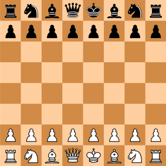

# mdbook-chess

Create chess boards in your mdbooks!



# Installation

Requires mdBook 0.5.4 or later in the 0.5 series and Rust 1.88 or later to build.

Simply:

```
cargo install mdbook-chess
```

And then add to your mdbook project as so:

```
# book.toml
[book]
authors = ["xd009642"]
language = "en"
src = "src"
title = "mdbook-chess"

[preprocessor.chess]
```

For an example book just look to the provided [demo-book](./demo-book).

# Usage

Chess boards are specified in YAML:

* board - "start" or a FEN string for a new position
* load - a saved board name or "start"; omitted means the starting position
* save - name to save board under (can be a list)
* moves - list of moves
* overwrite - boolean of whether to overwrite saved version of the board with these moves
* highlights - highlight a square on the board a list of squares
* lines - lines and arrows from square to square (currently only straight)

So we can create a starting board like using a code block with the language set to chess. Like:


    ```chess
    load: start
    ``` 

Or like:

    ```chess
    # Empty chess fences also show the starting position.
    ```

_For brevity/formating the backticks and "chess" language specifier will be omitted
for future examples._

Of course if we want to refer to this board later we need to save it. So we can
create a board with a name to refer to it later as so:

```chess
save: our_board
```

We can then load it and apply some moves - this will overwrite it so to do
alternatives can set overwrite to false and start from previous position. We
can also save multiple boards from a point for exploring many different routes:

```chess
load: our_board
save: ["ck-main", "ck-2", "ck-3"]
moves: ["e4", "c6", "d4", "d5"]
```

Arrows are done by writing the two squares and the line between them, there are
currently 3 styles:

* `-` a line
* `->` a single direction arrow
* `<->` a bidirectional arrow

And we can use them as so:

```chess
load: our_board
moves: ["e4", "c6", "d4", "d5"]
lines: ["e2->e4", "d1<->h5", "a4-h4"]
```


Invalid YAML, positions, moves and saved board names fail the build with the chapter
and chess block number. Saved boards are local to each chapter. Only chess fences
are replaced; surrounding Markdown is preserved. Backtick and tilde fences work,
including in lists and block quotes.

For an example of all the features in use please look to the demo book!

# Presentation

Each chess block can set these optional fields:

| Field | Values / default |
| --- | --- |
| `orientation` | `white` (default) or `black`; pieces stay upright |
| `coordinates` | `true` to show rank/file labels on all sides; default `false` |
| `theme` | `classic` (default), `green`, `blue`, `monochrome` |
| `colors` | Override `light`, `dark`, `highlight`, `arrow` with quoted `#RRGGBB` colors |
| `size` | Width in pixels, 64–2048; default 302, shrinks to fit its container |
| `align` | `left` (default), `center`, `right` |
| `caption` | Plain text beneath the board |
| `alt` | Accessible description; defaults to the side to move and FEN |
| `last-move` | Highlight the last move in this block; default `false` |
| `knight-lines` | The same syntax as `lines`, drawn with a right-angle bend; endpoints must be a knight’s move apart |
| `annotations` | Square-to-assessment map: `brilliant` (!!), `good` (!), `interesting` (!?), `dubious` (?!), `mistake` (?), `blunder` (??) |

Assessments are supplied by the author, not calculated by an engine. Themes use
explicit colors so diagrams remain legible when exported or printed. Highlight
squares, arrows and annotations use chess coordinates in either orientation.
See [the presentation examples](demo-book/src/presentation.md).

# Renderers and image files

`output` can be set in a chess block or as the default in `book.toml`:

```toml
[preprocessor.chess]
output = "auto"
```

| Output | Behavior |
| --- | --- |
| `auto` (default) | Inline SVG for `html`; PNG image links for other renderers |
| `inline-svg` | Embedded SVG with responsive layout and a visible caption; requires HTML support |
| `svg` | Standard Markdown image pointing to a standalone vector file |
| `png` | Standard Markdown image pointing to a raster image |

Image modes use `size` as their intrinsic pixel dimensions. `alt` becomes the
Markdown image description and `caption` becomes its image title. Put visible
captions in surrounding prose for portable documents; `align` controls inline
HTML only. PNG labels use fonts installed on the build machine (install a
sans-serif font when building in a minimal container).

Assets are written beneath `<book.src>/mdbook-chess-assets/`. Add that directory
to your book’s `.gitignore`. Filenames are content hashes, so duplicate diagrams
share files and unchanged builds leave their timestamps alone. Old files are not
automatically deleted; remove the generated directory before a clean build if
needed. The source directory must be writable when exporting images.

HTML and Chromium printing work with inline SVG and exported images. For Typst,
LaTeX/Pandoc, EPUB or other backends, choose an image format that the renderer can
load and ensure it resolves ordinary chapter-relative image links. PNG is the
conservative default. Renderer-specific layout and asset-copying behavior still
belong to that renderer; accepting `supports` does not guarantee that every
third-party backend can consume images. See the [portable examples](demo-book/src/portable.md),
including a nested chapter.

# Animation

Add `animation: {format: player}` to replay this block’s `moves` from its loaded
or starting position. The final position still participates in `save` and
`overwrite` exactly as for a static board.

```yaml
moves: [e4, e5, Nf3, Nc6, Bb5]
animation: {format: player, delay: 800, repeat: true}
coordinates: true
last-move: true
```

`player` (the default format) provides Previous/Next, a keyboard-operable slider,
and Play/Pause in HTML. It starts paused and stops when the page is hidden or
printed. With JavaScript disabled, the final board remains visible.

`format: gif` creates a downloadable GIF and a static preview with a Play/Stop
button. It never starts automatically, including when reduced motion is requested.
GIFs do not have interactive stepping; use the player for study. Exported GIFs
animate according to the application displaying them.

`delay` is milliseconds per position (default 800, range 100–60000 in steps of
10). `repeat` defaults to `true`. Animations accept 1–511 moves, giving at most
512 frames including the initial position. GIF frames are rasterized and encoded
one at a time; larger sizes and longer games increase build time and file size.

Arrows, explicit highlights and assessments appear only on the final frame;
`last-move` highlights each move during replay. The HTML animation takes precedence
over `output`. Non-HTML renderers receive a static final-position image using the
selected `output` format. HTML printing also shows the final position, regardless
of the selected replay step. No remote scripts or runtime services are needed;
HTML controls load generated JavaScript and CSS from the book’s asset directory.

See [the animation examples](demo-book/src/animation.md).

# Further maintenance

The notebook examples suggest these useful next additions:

* PGN import with comments and recursive variations, so complete annotated games
  do not need to be converted into YAML move arrays.
* A variation tree and move-list navigation linked to surrounding explanatory text.
* Coordinate/UCI move input (see issue #5), alongside SAN, with explicit notation
  selection to avoid ambiguous input.
* Per-move commentary and annotations in replays, instead of only final-frame annotations.
* Puzzle mode with a hidden solution and an accessible static fallback.
* Book-level presentation defaults and additional integration checks for specific
  EPUB, Pandoc and Typst mdBook plugins.

Chess variants and engine-derived evaluation bars remain outside the current
standard-chess scope. Author-supplied assessments do not imply engine analysis.

# License and Copyright

All chess SVGs were created by Wikimedia user Cburnett and are CC BY-SA 3.0
licensed. You can find them [here](https://commons.wikimedia.org/wiki/Category:SVG_chess_pieces)
I've edited them to template in a transform and remove the outer tags for
ease of board generation.

All other aspects of this project are currently licensed under the terms of both
the MIT license and the Apache License (Version 2.0). See LICENSE-MIT and
LICENSE-APACHE for more details.
